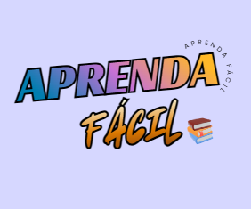

# Aprenda Fácil — Portal educacional e projetos de extensão PEX I–V

  

  <strong>Um ponto de partida para aprender, organizar os estudos e evoluir no seu ritmo.</strong>

  
  
  

---

## Sobre este repositório

Este repositório reúne os materiais dos **Projetos de Extensão I a V (PEX I–V)** realizados durante a graduação em Análise e Desenvolvimento de Sistemas, além do código-fonte do portal web **Aprenda Fácil**.

O histórico registra diferentes etapas de um percurso acadêmico: a concepção de um portal educacional, estudos de diagnóstico da Instituição Aurora (fictícia), análise de informações e apresentação de uma proposta de solução digital.

O repositório deve ser entendido como um conjunto de entregas acadêmicas e artefatos de desenvolvimento — não apenas como um único site.

## Portal Aprenda Fácil

O portal apresenta uma proposta de apoio ao aprendizado gratuito e acessível, com temas introdutórios, orientações para organização dos estudos e materiais complementares planejados.

**[Acessar o portal publicado](https://amanda-aandrade.github.io/aprenda-facil-pex/)**

### Páginas

| Arquivo | Conteúdo |
|---|---|
| `index.html` | Página inicial, áreas de aprendizado, busca local de conteúdos e atalhos para as seções do portal |
| `cursos.html` | Cards conceituais com trilhas introdutórias de HTML/CSS, JavaScript e lógica de programação |
| `guia.html` | Orientações de organização, rotina e técnicas de estudo, trilhas sugeridas e checklist interativo |
| `ebooks.html` | Temas sugeridos para materiais de leitura complementar; os arquivos ainda não estão disponíveis para download |
| `sobre.html` | Objetivos, público-alvo, justificativa, tecnologias e relação com o ODS 4 |
| `documentacao.html` | Documentação acadêmica com resumo, objetivos, escopo, metodologia, tecnologias e roadmap |
| `perfil.html` | Página demonstrativa de apresentação da trajetória de aprendizagem, sem autenticação |

### Funcionalidades implementadas no front-end

- Navegação compartilhada entre as páginas, com menu responsivo para telas menores e indicação da página atual.
- Busca local na página inicial por assuntos e recursos descritos no próprio portal. A busca não consulta uma API nem um catálogo remoto.
- Checklist de estudos interativo, com progresso visual e armazenamento das marcações no navegador por meio de `localStorage`.
- Opção para imprimir o checklist ou salvá-lo como PDF usando a função de impressão do navegador.
- Botão de retorno ao topo, com comportamento acessível e verificação da existência do componente em cada página.
- Atualização automática do ano no rodapé.

### Escopo e limitações atuais

O site é um front-end estático construído com HTML, CSS e JavaScript. Algumas áreas apresentam conceitos e interfaces planejadas, e não serviços completos:

- Os cards da página de cursos apresentam trilhas e tópicos introdutórios; não representam uma plataforma de cursos com aulas, matrícula, avaliações ou certificados.
- Matemática e Português aparecem como áreas em expansão na página inicial; não possuem trilhas de conteúdo implementadas nesta versão.
- A página de materiais apresenta temas sugeridos, mas não oferece arquivos para download.
- A página de perfil é demonstrativa; não há autenticação, conta de usuário ou sincronização de perfil.
- A busca trabalha com uma lista local e curada de páginas e assuntos; não realiza pesquisa dinâmica em banco de dados.
- O checklist salva as marcações somente no navegador atual. Limpar os dados do navegador pode remover esse progresso, e não existe sincronização entre dispositivos.
- Não há backend, banco de dados ou API integrados ao portal.

Essas distinções descrevem o estágio real do projeto sem atribuir funcionalidades que ainda não existem.

## Organização dos Projetos de Extensão

### PEX I — Aprenda Fácil

Etapa de concepção e desenvolvimento inicial do portal educacional, com foco em organizar conteúdos introdutórios e facilitar o acesso a materiais de estudo.

**Eixo apresentado no portal:** ODS 4 — Educação de Qualidade.

[Consultar documentação do PEX I](./pex-01/README.md)

### PEX II — Diagnóstico da Instituição Aurora

Estudo de uma instituição fictícia de acolhimento emocional, com identificação de situações-problema operacionais, tecnológicas e organizacionais. O trabalho registra desafios de organização de atendimentos, uso de processos manuais, segurança das informações e acesso ao acolhimento.

**Eixo do projeto:** ODS 3 — Saúde e Bem-estar.

[Consultar documentação do PEX II](./pex-02/README.md)

### PEX III — Análise e proposição de soluções

Aprofundamento do diagnóstico da Aurora, com análise de processos, riscos, requisitos e proposição conceitual de soluções digitais.

[Consultar documentação do PEX III](./pex-03/README.md)

### PEX IV — Coleta e análise de dados

Etapa dedicada à coleta, organização e análise de informações para apoiar o diagnóstico e a proposição de soluções tecnológicas. A documentação cita ferramentas como Google Forms, Trello e Excel.

[Consultar documentação do PEX IV](./pex-04/README.md)

### PEX V — Relato final e apresentação

Etapa de consolidação dos trabalhos anteriores, com relato, simulação de uso e apresentação de uma solução web. O documento do PEX V descreve o portal Aprenda Fácil como artefato de demonstração relacionado à proposta para a Instituição Aurora.

[Consultar documentação do PEX V](./pex-05/README.md)

## Relação entre os temas e os ODS

Os materiais reunidos neste repositório apresentam dois recortes temáticos que precisam ser lidos em seu contexto:

- **Portal Aprenda Fácil / PEX I:** a interface pública e suas páginas de apresentação relacionam o portal à educação e ao **ODS 4 — Educação de Qualidade**.
- **Documentação da Instituição Aurora / PEX II–V:** os relatórios tratam de uma instituição fictícia de acolhimento emocional e relacionam essa linha de trabalho ao **ODS 3 — Saúde e Bem-estar**.

O relatório do PEX V descreve o Aprenda Fácil como parte da apresentação da solução para a Aurora. Já o portal publicado atualmente apresenta conteúdos de apoio ao estudo e educação. A aplicação disponível não é um serviço de saúde, não oferece atendimento psicológico e não realiza gestão de pacientes.

## Tecnologias e ferramentas

### Utilizadas no portal

- **HTML5:** estrutura semântica das páginas.
- **CSS3:** identidade visual, responsividade, Grid, Flexbox, estados de foco e impressão.
- **JavaScript:** navegação responsiva, busca local, checklist e interações da interface.
- **localStorage:** persistência local do checklist no navegador.
- **Google Fonts (Poppins):** tipografia carregada externamente.

### Ferramentas e apoio ao desenvolvimento documentados

- Visual Studio Code.
- Git e GitHub.
- Canva e Miro para prototipação e organização visual.
- Google Forms, Trello e Excel nas atividades documentadas de coleta e organização de dados do PEX IV.

## Estrutura do repositório

~~~text
aprenda-facil-pex/
├── index.html
├── cursos.html
├── guia.html
├── ebooks.html
├── sobre.html
├── documentacao.html
├── perfil.html
├── style.css
├── script.js
├── logo-aprenda-facil.png
├── README.md
├── pex-01/
│   └── README.md
├── pex-02/
│   └── README.md
├── pex-03/
│   └── README.md
├── pex-04/
│   └── README.md
└── pex-05/
    └── README.md
~~~

Cada pasta PEX contém a documentação específica da respectiva etapa. Os relatórios e evidências associados estão referenciados nos READMEs das etapas quando aplicável.

## Como executar localmente

O portal é estático e não exige instalação de dependências via npm.

### 1. Clonar o repositório

~~~bash
git clone https://github.com/Amanda-AAndrade/aprenda-facil-pex.git
~~~

### 2. Entrar na pasta

~~~bash
cd aprenda-facil-pex
~~~

### 3. Iniciar um servidor local

**Windows (Python 3):**

~~~powershell
py -m http.server 5500
~~~

**Linux ou macOS (Python 3):**

~~~bash
python3 -m http.server 5500
~~~

### 4. Abrir no navegador

~~~text
http://localhost:5500
~~~

Também é possível abrir a pasta no Visual Studio Code e utilizar a extensão Live Server.

## Comandos úteis

Verificar alterações:

~~~bash
git status
~~~

Atualizar a cópia local:

~~~bash
git pull origin main
~~~

Registrar e enviar alterações:

~~~bash
git add .
git commit -m "feat: aprimora interface do Aprenda Fácil"
git push origin main
~~~

Não é necessário executar `npm install` nesta versão.

## Publicação no GitHub Pages

O site está publicado pelo GitHub Pages:

**[Abrir Aprenda Fácil](https://amanda-aandrade.github.io/aprenda-facil-pex/)**

Para configurar ou revisar a publicação, acesse **Settings → Pages**, selecione **Deploy from a branch**, escolha `main` e a pasta raiz (`/root`).

## Próximas evoluções

- [ ] Ampliar e revisar o catálogo de conteúdos da busca local.
- [ ] Transformar as trilhas conceituais em conteúdos efetivamente disponíveis.
- [ ] Produzir ou selecionar materiais de leitura e disponibilizar links autorizados.
- [ ] Avaliar conteúdos introdutórios para Matemática e Português.
- [ ] Realizar testes de acessibilidade e usabilidade com pessoas usuárias.
- [ ] Definir o escopo de funcionalidades que justificaria um backend e persistência de dados.

## Autoria

**Amanda Andrade**  
Projeto desenvolvido no contexto da graduação em **Análise e Desenvolvimento de Sistemas**, como parte dos Projetos de Extensão I a V.

---

<strong>Aprenda Fácil — conhecimento acessível, um passo de cada vez.</strong>

